# 🎯 Awesome Automated Visual Regression Testing

  

 

**A Curated Directory of SaaS Platforms, Open-Source Tools, Pixel Diff Engines & CI/CD Visual Quality Gates.**  
*Catch visual bugs, layout shifts, styling regressions, and component inconsistencies automatically.*

[🌟 Star on GitHub](https://github.com/ishandutta2007/Awesome-Automated-Visual-Regression-Testing) • [🍴 Fork Repository](https://github.com/ishandutta2007/Awesome-Automated-Visual-Regression-Testing/fork) • [🤝 How to Contribute](#-how-to-contribute) • [💖 Sponsor & Support](#-support)

---

## 📖 Introduction & Overview

**Automated Visual Regression Testing (VRT)** inspects the visual appearance of applications by automatically capturing screenshots or DOM snapshots across browsers, screen sizes, and operating systems, comparing them against approved baseline snapshots to identify visual deviations.

Whether building web apps, mobile apps, or design system component libraries, automated visual diffing guarantees:
- 🛡️ **Zero Layout Regressions:** Catch unintended CSS regressions, margin collapses, overflow glitches, and unexpected responsive wrapping.
- 🎨 **Design System Consistency:** Validate atomic component states (hover, focus, disabled, dark mode) in Storybook, Vitest, and Cypress.
- ⚡ **Continuous CI/CD Quality Gates:** Block pull requests with pixel or structural DOM mismatches before code hits staging or production.

---

## 📑 Table of Contents
- [📊 Sector Overview & Market Dynamics](#-sector-overview--market-dynamics)
- [☁️ SaaS & Hosted Platforms](#️-saas--hosted-platforms)
- [💻 Open-Source GitHub Projects](#-open-source-github-projects)
- [🛠️ Architectural Recipe: Custom Visual Quality Gates](#️-architectural-recipe-custom-visual-quality-gates)
- [🤝 How to Contribute](#-how-to-contribute)
- [⭐ Star History](#-star-history)
- [💖 Support](#-support)
- [📄 Disclaimer](#-disclaimer)

---

## 📊 Sector Overview & Market Dynamics

The Automated Visual Regression Testing market is estimated at **$1.3B to $1.8B** (scaling toward **$5.0B+** by the mid-2030s at ~13% CAGR), embedded within the broader **$25B–$40B+** automated testing market. 

The sector exhibits **moderate fragmentation with high concentration around core test clouds**: large multi-product testing clouds (BrowserStack, Sauce Labs, LambdaTest) dominate unified test infrastructure via acquisitions and platform bundles, while specialized visual-first platforms (Applitools, Chromatic, Argos CI, Happo) capture dedicated frontend, component-driven, and CI-native visual diffing workflows rather than a single winner-take-all monopoly.

---

## ☁️ SaaS & Hosted Platforms

| Platform | Company Scale (Valuation / Revenue) | Starting Pricing (Paid Tier) | Free Tier Limits / Free Trial | Key Capabilities & Highlights |
| :--- | :--- | :--- | :--- | :--- |
| **[BrowserStack Visual Regression Testing (Percy)](https://percy.io/)** | **~$4.0B Valuation** / ~$225M–$230M ARR | **$149/mo** (billed annually) or $199/mo | **5,000 screenshots/mo** (Web) & 1,000 screenshots/mo (App Percy) free forever; unlimited users & projects | Cloud visual testing integrated with BrowserStack, capturing DOM snapshots and rendering across browsers with AI-powered diff noise reduction and scheduled Visual Scanner monitoring [citation:1][citation:4]. |
| **[Sauce Labs Visual Testing](https://docs.saucelabs.com/visual-testing/)** | **~$500M–$613M Valuation** / ~$90M–$100M Revenue | **$149/mo** (Virtual Cloud, billed annually) | **28-day free trial**; paid plans include 500 visual snapshots/mo (no perpetual free tier except for open source) | Automated visual comparison across browsers, devices, and OSes with side-by-side DOM diff inspection, baseline matching by test metadata, and Figma design export integration [citation:5][citation:15]. |
| **[LambdaTest SmartUI](https://www.lambdatest.com/support/docs/smartui-baseline-management/)** | **~$400M Valuation** (Series D) / ~$25M–$30M+ ARR | **$199/mo** (billed annually) | **2,000 visual screenshots** free allocation (no credit card required) | Visual regression platform with flexible baseline management (project, branch, dynamic, build-based), CLI-driven baseline marking, and Git-integrated baseline strategies [citation:6]. |
| **[Applitools Eyes](https://applitools.com/)** | **$250M Valuation** (Acquired by Thoma Bravo) / ~$30M Revenue | **$667/mo** (Starter plan, billed annually at $8,004/yr) | **14-day fully featured free trial**; starter evaluation tier capped at 50 page units / 1,000 checkpoints | Visual AI platform with deterministic matching engines (Strict, Layout, Content), native Figma baseline mapping, and MCP tools for AI coding agents to inspect pixel-exact diffs directly in IDE workflows [citation:2]. |
| **[Chromatic](https://www.chromatic.com/)** | **~$5.6M ARR** (Bootstrapped / Indie-backed) | **$179/mo** (Starter plan, 35,000 billed snapshots/mo) | **5,000 snapshots/mo** free forever; unlimited projects & collaborators (Chrome testing, no credit card required) | Visual testing for Storybook and Vitest Browser Mode, uploading test snapshots to cloud environment for parallel capture, TurboSnap diff optimization, and team-wide diff review in pull requests [citation:3][citation:13]. |
| **[Argos CI](https://argos-ci.com/)** | **Independent / Bootstrapped** (<$2M ARR est.) | **$100/mo** (Pro plan, includes 35,000 screenshots/mo) | **5,000 screenshots/mo** free forever (Hobby Plan, no credit card required) | Visual testing service focused on modern JavaScript toolchains, providing Vitest Browser Mode, Playwright, and Cypress integrations with cloud-based screenshot comparison and review workflows [citation:7]. |
| **[Happo.io](https://happo.io/)** | **Independent / Bootstrapped** (<$2M ARR est.) | **$149/mo** (Starter plan, includes 50,000 snapshots/mo) | **5,000 snapshots/mo** free forever (Chrome, unlimited users & concurrent runs, never auto-billed on overage) | Visual regression and accessibility testing combined in a single review, catching layout shifts, contrast violations, and animation changes with keyboard-friendly approve/reject workflows and GitHub integration [citation:9]. |

---

## 💻 Open-Source GitHub Projects

Curated open-source projects, visual testing frameworks, pixel comparators, and screenshot runners sorted by GitHub_Stars (descending):

1. **[BackstopJS](https://github.com/garris/BackstopJS)**   
   Catch CSS curve balls. Node.js visual regression testing tool with Playwright and Puppeteer browser runners, DOM selector targeting, interactive in-browser visual diff reports, and CI integration scripts.

2. **[Pixelmatch](https://github.com/mapbox/pixelmatch)**   
   The smallest, simplest, and fastest JavaScript pixel-level image comparison library, powering visual regression engines worldwide with anti-aliasing detection and perceptual color difference metrics.

3. **[Wraith](https://github.com/bbc/wraith)**   
   BBC's responsive screenshot comparison tool. Uses headless browsers to take screenshots of web pages at various screen widths and compares them side-by-side using ImageMagick to uncover responsive design flaws.

4. **[Resemble.js](https://github.com/rsmbl/Resemble.js)**   
   Image analysis and comparison in Node.js and the browser. Supports transparent ignore-boxes, perceptual color distance thresholds, and custom visual tolerance settings.

5. **[jest-image-snapshot](https://github.com/americanexpress/jest-image-snapshot)**   
   American Express's popular Jest matcher for image comparison, enabling seamless visual assertions (`toMatchImageSnapshot()`) in unit and integration test workflows.

6. **[Odiff](https://github.com/dmtrKovalenko/odiff)**   
   SIMD-accelerated, high-performance pixel-diffing engine with Node.js and CLI interfaces. Faster than conventional JS pixel matchers with intelligent layout anomaly detection and anti-aliasing handling.

7. **[awesome-regression-testing](https://github.com/mojoaxel/awesome-regression-testing)**   
   A curated index of resources, articles, research papers, and tools centered on visual and automated regression testing.

8. **[Loki](https://github.com/oblador/loki)**   
   Visual regression testing for Storybook projects. Operates seamlessly with zero configuration in Dockerized environments to eliminate cross-platform font rendering and anti-aliasing inconsistencies.

9. **[screenshot-tests-for-android](https://github.com/meta/screenshot-tests-for-android)**   
   Meta's library to generate fast, deterministic screenshots during Android instrumentation tests, verifying layouts across multiple densities and device configurations.

10. **[Lost Pixel](https://github.com/lost-pixel/lost-pixel)**   
    Holistic open-source visual regression testing engine for Storybook, Ladle, Next.js, and modern frontend frameworks, serving as a self-hosted alternative to Percy and Chromatic.

11. **[reg-suit](https://github.com/reg-viz/reg-suit)**   
    Flexible TypeScript-based visual regression testing workflow tool that synchronizes screenshot baselines with cloud storage (AWS S3, Google Cloud Storage), integrating with GitHub PR notifications.

12. **[gemini](https://github.com/gemini-testing/gemini)**   
    Utility for regression testing the visual appearance of web pages via Selenium WebDriver (pioneered visual regression testing in enterprise frontend pipelines).

13. **[Testplane (ex-hermione)](https://github.com/gemini-testing/testplane)**   
    Browser test runner based on Mocha and WebdriverIO with built-in visual comparison, auto-retries, GUI reporter, and parallel execution for complex web suites.

14. **[Visual Regression Tracker](https://github.com/visual-regression-tracker/visual-regression-tracker)**   
    Open-source, self-hosted visual testing platform with Docker deployment, baseline history tracking, ignore regions, and multi-engine support (Pixelmatch, Looks-Same, Odiff).

15. **[Happo (Open-Source Core)](https://github.com/happo/happo)**   
    Open-source visual diffing tool for user interfaces in CI pipelines, serving as the foundational architectural core for Happo.io.

16. **[AyeSpy](https://github.com/newsuk/AyeSpy)**   
    Performant visual regression testing tool developed by News UK, designed for continuous integration with configurable comparison thresholds and Selenium grid support.

17. **[jest-puppe-shots](https://github.com/macku/jest-puppe-shots)**   
    Jest plugin for capturing and validating screenshots of React components with Puppeteer, bringing component-level visual assertions to unit test workflows.

18. **[nightwatch-vrt](https://github.com/Crunch-io/nightwatch-vrt)**   
    Visual regression testing extension for the Nightwatch.js test framework, enabling automated screenshot assertions within existing end-to-end Nightwatch test suites.

19. **[ChromeDiff](https://github.com/katat/ChromeDiff)**   
    Lightweight Node.js visual regression library using headless Chrome and Resemble.js for local image comparisons in simple testing pipelines.

---

## 🛠️ Architectural Recipe: Custom Visual Quality Gates

When architecting a vendor-neutral, self-hosted visual regression pipeline in CI/CD, the following open-source stack is widely recommended:

- 📸 **Screenshot Capture:** [Playwright Test](https://playwright.dev/) or [Vitest Browser Mode](https://vitest.dev/) (`toMatchScreenshot`).
- 🔍 **Pixel Diff Engine:** [Pixelmatch](https://github.com/mapbox/pixelmatch) or [Odiff](https://github.com/dmtrKovalenko/odiff) for high-speed SIMD comparison.
- 🗄️ **Baseline & History Management:** [Visual Regression Tracker](https://github.com/visual-regression-tracker/visual-regression-tracker) or [reg-suit](https://github.com/reg-viz/reg-suit) with AWS S3 / GCS.
- 🤖 **CI/CD Integration:** GitHub Actions pull request checks with status commenting and artifact diff uploading.

---

## 🤝 How to Contribute

Contributions are warmly welcomed! Help us keep this guide accurate, fresh, and comprehensive:

1. 🍴 Fork the repository.
2. 🌿 Create a new branch: `git checkout -b feature/add-new-tool`.
3. 📝 Add or edit entries in `README.md` maintaining table formatting, pricing transparency, and accurate Stars_Badge links.
4. 🚀 Push changes and open a Pull Request with a clear description.

---

## ⭐ Star History

---

## 💖 Support

If you found this visual regression testing resource helpful, please consider supporting the project:

- ⭐ **Star this repository** to help others discover it on GitHub.
- 🍴 **Fork and share** it with your frontend, QA, and platform engineering teams.
- ☕ **Buy me a coffee & sponsor ongoing open-source maintenance:**  
  👉 **[Sponsor on GitHub Sponsors](https://github.com/sponsors/ishandutta2007)**

Thank you for your generous support and commitment to open-source software! 🙌

---

## 📄 Disclaimer

- This is a **community-curated** list — not exhaustive and not an official commercial endorsement.
- Visual testing tools must be configured with appropriate thresholds, anti-aliasing tolerances, and ignore regions to prevent false positives caused by animations, dynamic date/time strings, and platform font differences.
- Pricing, free tier limits, and corporate scale figures reflect publicly available documentation and market research benchmarks as of 2026.

---

**Made with ❤️ for frontend engineers, design system maintainers, QA teams, and platform developers.**  
*Let's make automated visual regression testing open, reliable, and accessible.*

